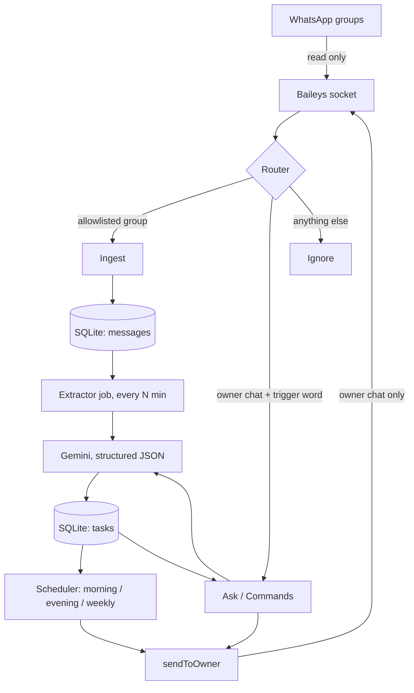

# Architecture

This document is for developers. For setup and usage, see [README.md](README.md).

## Big picture

Maya has four parts:

1. **Channel** — talks to WhatsApp (read groups, send to the owner).
2. **Store** — SQLite database (messages + tasks).
3. **Brain** — Gemini, used for task extraction and answering questions.
4. **Scheduler** — cron jobs for reminders and the weekly plan.



### Key design decisions

- **Batch extraction.** The AI runs on batches of unprocessed messages every `EXTRACT_INTERVAL_MIN` minutes, not on every message. This means fewer API calls, lower cost, and better context (it can see "quiz moved to Monday" right after "quiz on Friday").
- **Update, don't duplicate.** The extractor gets the list of open tasks with each batch, so it can update an existing task (a new date, or cancelled) instead of creating a second one.
- **One way out.** Only `sendToOwner()` can send messages. This is the main safety rule.
- **Loop guard.** Every reply starts with `🤖 <BOT_NAME>:`. The router ignores any message starting with that prefix.
- **Sources are pluggable (later).** WhatsApp is the first source. Future sources (LMS, email) write into the same `messages`/`tasks` tables, so reminders and Q&A work for all of them.

## Tech stack

| Part | Choice | Notes |
|---|---|---|
| Runtime | Node.js 22+ (develop on Node 24), TypeScript, `tsx` | ESM only; `better-sqlite3` 13.x requires Node.js 22+ |
| WhatsApp | `baileys` `7.0.0-rc14`, exact pin | No stable v7 npm release as of 2026-10-16; unofficial; see README warning |
| QR | `qrcode-terminal` via `connection.update` | `printQRInTerminal` is deprecated |
| DB | `better-sqlite3` | WAL mode, a single file |
| AI | `@google/genai` | Model from `GEMINI_MODEL` |
| Validation | `zod` | For env and AI output |
| Scheduler | `node-cron` | Always pass `timezone` |
| Logging | `pino` | Same logger Baileys uses |
| Lint/format | `eslint` + `prettier` | |

## Repository structure

```text
maya-assistant/
├── src/
│   ├── index.ts                  # Entry: env → DB → WhatsApp → jobs; graceful shutdown
│   ├── config/
│   │   └── env.ts                # zod-validated env, typed config object
│   ├── channels/
│   │   └── whatsapp/
│   │       ├── connection.ts     # Socket, QR, reconnect with backoff, saveCreds
│   │       ├── identity.ts       # Owner JIDs (PN + LID) for self/separate mode
│   │       ├── parse.ts          # Text from conversation, extendedText, image/doc captions
│   │       ├── router.ts         # Decide: ingest | ask | ignore
│   │       └── send.ts           # sendToOwner(): the ONLY sender, with prefix + rate limit
│   ├── db/
│   │   ├── client.ts             # better-sqlite3 connection
│   │   ├── schema.sql            # Tables + indexes
│   │   ├── migrate.ts            # Applies schema on start
│   │   └── repos/
│   │       ├── messages.ts       # insert (dedupe), getUnprocessed, quarantine, markProcessed, recent
│   │       └── tasks.ts          # upsert, dueBetween, open, markDone, markReminded
│   ├── ai/
│   │   ├── gemini.ts             # Client wrapper, retry with backoff on 429/5xx
│   │   ├── prompts.ts            # Extraction, ask, weekly-plan prompts
│   │   └── schemas.ts            # zod schemas for AI JSON
│   ├── features/
│   │   ├── ingest.ts             # Save allowlisted group messages
│   │   ├── extract.ts            # Batch → AI → upsert tasks → mark processed
│   │   ├── commands.ts           # No-AI commands: help, tasks, done <id>
│   │   ├── ask.ts                # Free-form questions answered with AI
│   │   ├── digests.ts            # Morning (today) and evening (tomorrow) reminders
│   │   └── weeklyPlan.ts         # Weekly study/work plan
│   ├── scheduler/
│   │   └── jobs.ts               # Registers every cron job
│   └── utils/
│       ├── logger.ts
│       └── time.ts               # Timezone helpers, ISO formatting
├── scripts/
│   ├── list-groups.ts            # Prints group names + JIDs
│   └── backup-db.ts              # Copies the DB file with a timestamp
├── data/                         # maya.db (git-ignored)
├── auth_info/                    # WhatsApp session (git-ignored, never commit)
├── .env.example
├── .gitignore
├── eslint.config.js
├── tsconfig.json
├── package.json
├── README.md
├── ARCHITECTURE.md
├── ROADMAP.md
├── AGENTS.md
└── LICENSE
```

## Database schema

```sql
CREATE TABLE IF NOT EXISTS messages (
  id           INTEGER PRIMARY KEY AUTOINCREMENT,
  source       TEXT NOT NULL DEFAULT 'whatsapp',
  external_id  TEXT NOT NULL,              -- WhatsApp message id
  chat_id      TEXT NOT NULL,
  chat_name    TEXT,
  sender_name  TEXT,
  text         TEXT NOT NULL,
  sent_at      TEXT NOT NULL,              -- ISO UTC, from the message timestamp
  processed    INTEGER NOT NULL DEFAULT 0, -- 0 = pending, 1 = processed, -1 = quarantined
  extract_attempts INTEGER NOT NULL DEFAULT 0,
  failure_batch_id INTEGER REFERENCES extraction_failures(id),
  UNIQUE (source, chat_id, external_id)
);

CREATE TABLE IF NOT EXISTS extraction_failures (
  id                INTEGER PRIMARY KEY AUTOINCREMENT,
  failed_at         TEXT NOT NULL DEFAULT (strftime('%Y-%m-%dT%H:%M:%fZ', 'now')),
  owner_notified_at TEXT               -- NULL until sendToOwner succeeds
);

CREATE TABLE IF NOT EXISTS tasks (
  id               INTEGER PRIMARY KEY AUTOINCREMENT,
  source_msg_id    INTEGER REFERENCES messages(id), -- message that created the task
  last_msg_id      INTEGER REFERENCES messages(id), -- message that last created/updated/cancelled it
  subject          TEXT,                   -- course or topic, e.g. "MTH501"
  type             TEXT NOT NULL,          -- quiz | assignment | exam | announcement | venue_change | class | other
  title            TEXT NOT NULL,
  details          TEXT,
  due_at           TEXT,                   -- ISO UTC; NULL if no date
  status           TEXT NOT NULL DEFAULT 'open',  -- open | done | cancelled
  reminded_evening INTEGER NOT NULL DEFAULT 0,
  reminded_morning INTEGER NOT NULL DEFAULT 0,
  created_at       TEXT NOT NULL DEFAULT (strftime('%Y-%m-%dT%H:%M:%fZ', 'now')),
  updated_at       TEXT NOT NULL DEFAULT (strftime('%Y-%m-%dT%H:%M:%fZ', 'now'))
);

CREATE INDEX IF NOT EXISTS idx_messages_unprocessed ON messages(processed, sent_at);
CREATE INDEX IF NOT EXISTS idx_messages_failure_batch ON messages(failure_batch_id);
CREATE INDEX IF NOT EXISTS idx_tasks_due ON tasks(status, due_at);
```

Store times in **UTC**, and convert to `TIMEZONE` only when you show them or schedule something.
Normalize stored timestamp inputs to the fixed-millisecond ISO UTC form (`YYYY-MM-DDTHH:mm:ss.sssZ`), so SQLite text ordering works at interval boundaries.
Application updates must also write `updated_at` in the same ISO UTC format. Reset both reminder flags when a task's due date changes. Mark a reminder only after `sendToOwner()` reports a successful send.
Pass the due date selected for the reminder to `markReminded`; it must leave the flags unchanged if the task's due date changed while the message was being sent.
Reminder sends and database updates cannot be one atomic operation; a crash between them may cause a rare duplicate reminder. Exactly-once reminder delivery is not required.

## AI extraction contract

**Input:** the batch of new messages (time, chat, sender, text), the open tasks (id, subject, type, title, due_at), the current time, and `TIMEZONE`.

**Output** (validated with zod):

```json
{
  "actions": [
    { "op": "create", "subject": "MTH501", "type": "quiz", "title": "Quiz 2",
      "details": "Lectures 23-30", "due_at": "2026-10-20T04:00:00Z", "source_msg_ref": 12 },
    { "op": "update", "task_id": 4, "due_at": "2026-10-21T04:00:00Z", "details": "Moved to Tuesday", "source_msg_ref": 13 },
    { "op": "cancel", "task_id": 7, "reason": "Class cancelled", "source_msg_ref": 14 }
  ]
}
```

Rules for the AI:
- Turn relative dates ("tomorrow", "next Monday") into absolute dates using the message's own time, not the current time.
- If there's no clear date, use `due_at: null`. Never guess.
- Ignore chatter ("ok", "thanks", stickers).
- Every action has `source_msg_ref`, a `messages.id` from the current batch. Reject any action that refers outside that batch; accept update/cancel `task_id` values only from the open tasks supplied to the model. Set `tasks.source_msg_id` and `tasks.last_msg_id` on create; update `last_msg_id` on update/cancel. AI output never chooses a WhatsApp recipient.

If validation or extraction fails, log it without message text, increment `extract_attempts` for each message in the batch, and retry next run. After 3 failed attempts, quarantine the affected messages with `processed = -1` (never treat them as successfully processed), create one `extraction_failures` row for that failed batch, and link those messages through `failure_batch_id`. In Step 7, notify the owner once per failed batch through `sendToOwner()` with the failure batch ID and message IDs, without including message text. Set `owner_notified_at` only after a successful send; retry pending notifications. A crash between sending and recording success can cause a duplicate notification.

## Identity and modes

- **`self` mode:** the owner is the account itself. Owner chat = self-chat. Detect it by matching `remoteJid` (or its alternate JID, when present) against *both* available `sock.user.id` (PN) and `sock.user.lid` (LID), normalized with `jidNormalizedUser`, and require `fromMe === true`. A trigger word is required.
- **`separate` mode:** the owner is `OWNER_JID` (match its PN or resolved LID, including the alternate JID when present). No trigger word is needed. If the LID mapping is unavailable, fail closed for an unrecognized LID rather than treating any direct chat as the owner.

Baileys 7 uses LIDs (`...@lid`) by default. `jidNormalizedUser` strips device suffixes but does not map PN to LID; use `sock.signalRepository.lidMapping.getLIDForPN` where needed. Never assume a JID is a phone number.

## Safety settings

- `markOnlineOnConnect: false`, `syncFullHistory: false`
- `sendToOwner` rate limit: at most `MAX_REPLIES_PER_HOUR` (default 20)
- Reconnect with exponential backoff (cap at 5 min). Stop if logged out.
- Never log full message text at `info` level.
