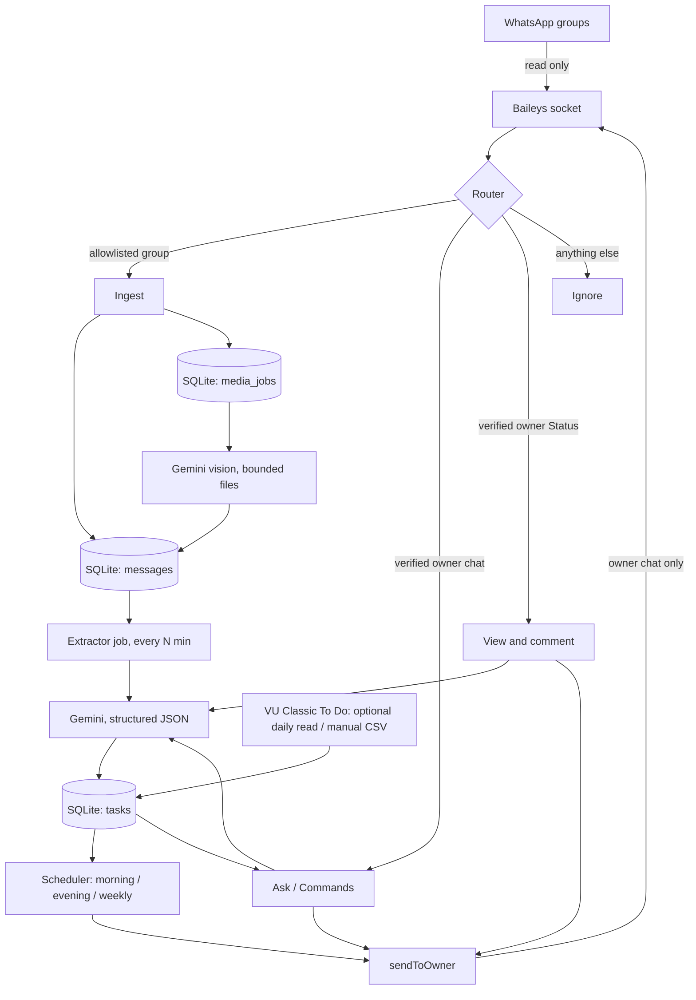

# Architecture

This document is for developers. For setup and usage, see [README.md](README.md).

## Big picture

Maya has four parts:

1. **Channel** — talks to WhatsApp (read groups, send to the owner).
2. **Store** — SQLite database (messages + tasks).
3. **Brain** — Gemini, used for task extraction and answering questions.
4. **Scheduler** — cron jobs for reminders and the weekly plan.



### Key design decisions

- **Batch extraction.** The AI runs on batches of unprocessed messages every `EXTRACT_INTERVAL_MIN` minutes, not on every message. This means fewer API calls, lower cost, and better context (it can see "quiz moved to Monday" right after "quiz on Friday").
- **Media queue.** Supported images and PDFs from allowlisted groups are stored as bounded, retryable media jobs before text extraction. Pending placeholders never enter task extraction or Q&A. Completed text enters the same `messages` table. The queue stores the WhatsApp media key and metadata, so it needs the same private storage protection as auth data.
- **Calendar queue.** Task inserts and meaningful changes enqueue a durable calendar job. Event IDs combine a random, persistent database namespace with the task ID using Google-compatible characters, so retries after a crash update the same event without colliding with another installation. A revision counter keeps concurrent changes queued. Calendar sync is off until the owner completes OAuth and enables it.
- **Update, don't duplicate.** The extractor gets the list of open tasks with each batch, so it can update an existing task (a new date, or cancelled) instead of creating a second one.
- **One way out.** Only `sendToOwner()` can send messages. This is the main safety rule.
- **Loop guard.** Self mode keeps the `🤖 <BOT_NAME>:` prefix and ignores it on input. Separate mode sends plain text and ignores Maya's outgoing messages through `key.fromMe`.
- **Status isolation.** In separate mode, Maya marks only the verified owner's Status as viewed and sends a short private comment through `sendToOwner()` when it has readable text, a caption, or supported photo/video media. Status content goes to Gemini for that comment only; it is not stored or used for task extraction or future answers. Photo/video downloads are bounded by `MEDIA_MAX_BYTES`. Unsupported or oversized media without a caption is viewed without a comment. Other people's Status and all other broadcasts are ignored. An alternate PN/LID on a broadcast message never makes it an owner chat.
- **Sources are pluggable.** `Source<T>` owns an input lifecycle and emits normalized items. WhatsApp emits group messages into `messages`; the VU CSV importer and optional daily portal reader normalize only Classic To Do quizzes and assignments and upsert them through the same source ID mapping. The portal reader opens a fresh headless browser for each check and does not retain a login session.

## Tech stack

| Part | Choice | Notes |
|---|---|---|
| Runtime | Node.js 22+ (develop on Node 24), TypeScript, `tsx` | ESM only; `better-sqlite3` 13.x requires Node.js 22+ |
| WhatsApp | `baileys` `7.0.0-rc14`, exact pin | No stable v7 npm release as of 2026-10-16; unofficial; see README warning |
| QR | `qrcode-terminal` via `connection.update` | `printQRInTerminal` is deprecated |
| DB | `better-sqlite3` | WAL mode, a single file |
| AI | `@google/genai` | Model from `GEMINI_MODEL` |
| Validation | `zod` | For env and AI output |
| Scheduler | `node-cron` | Always pass `timezone` |
| Optional VU reader | `playwright` + Chromium | Official LMS sign-in in a fresh browser; no CAPTCHA bypass |
| Logging | `pino` | Application logs; Baileys logging is silent to avoid raw WhatsApp payloads |
| Lint/format | `eslint` + `prettier` | |

## Repository structure

```text
maya-assistant/
├── src/
│   ├── index.ts                  # Entry: env → DB → WhatsApp → jobs; graceful shutdown
│   ├── config/
│   │   └── env.ts                # zod-validated env, typed config object
│   ├── channels/
│   │   └── whatsapp/
│   │       ├── connection.ts     # Socket, QR, reconnect with backoff, saveCreds
│   │       ├── identity.ts       # Owner JIDs (PN + LID) for self/separate mode
│   │       ├── parse.ts          # Text from conversation, extendedText, image/doc captions
│   │       ├── router.ts         # Decide: ingest | ask | ignore
│   │       └── send.ts           # Owner-only sending, read receipts, typing presence, rate limit
│   ├── db/
│   │   ├── client.ts             # better-sqlite3 connection
│   │   ├── schema.sql            # Tables + indexes
│   │   ├── migrate.ts            # Applies schema on start
│   │   └── repos/
│   │       ├── messages.ts       # insert (dedupe), getUnprocessed, quarantine, markProcessed, recent
│   │       ├── media.ts          # Pending media jobs, completion, and quarantine
│   │       └── tasks.ts          # upsert, dueBetween, open, markDone, markReminded
│   ├── ai/
│   │   ├── gemini.ts             # Client wrapper, retry with backoff on 429/5xx
│   │   ├── prompts.ts            # Extraction, ask, weekly-plan prompts
│   │   └── schemas.ts            # zod schemas for AI JSON
│   ├── features/
│   │   ├── ingest.ts             # Save allowlisted group messages
│   │   ├── media.ts              # Retryable image/PDF reading before text extraction
│   │   ├── status.ts             # Bounded owner Status reading and private comments
│   │   ├── extract.ts            # Batch → AI → upsert tasks → mark processed
│   │   ├── commands.ts           # No-AI commands: help, tasks, done <id>
│   │   ├── ask.ts                # Free-form questions answered with AI
│   │   ├── digests.ts            # Morning (today) and evening (tomorrow) reminders
│   │   └── weeklyPlan.ts         # Weekly study/work plan
│   ├── scheduler/
│   │   └── jobs.ts               # Registers every cron job
│   └── utils/
│       ├── logger.ts
│       └── time.ts               # Timezone helpers, ISO formatting
├── scripts/
│   ├── list-groups.ts            # Prints group names + JIDs
│   └── backup-db.ts              # SQLite online backup; retains seven completed snapshots
├── data/                         # maya.db (git-ignored)
├── auth_info/                    # WhatsApp session (git-ignored, never commit)
├── .env.example
├── .gitignore
├── eslint.config.js
├── tsconfig.json
├── package.json
├── README.md
├── ARCHITECTURE.md
├── ROADMAP.md
├── AGENTS.md
└── LICENSE
```

## Database schema

```sql
CREATE TABLE IF NOT EXISTS messages (
  id           INTEGER PRIMARY KEY AUTOINCREMENT,
  source       TEXT NOT NULL DEFAULT 'whatsapp',
  external_id  TEXT NOT NULL,              -- WhatsApp message id
  chat_id      TEXT NOT NULL,
  chat_name    TEXT,
  sender_name  TEXT,
  text         TEXT NOT NULL,
  sent_at      TEXT NOT NULL,              -- ISO UTC, from the message timestamp
  processed    INTEGER NOT NULL DEFAULT 0, -- 0 = pending, 1 = processed, -1 = quarantined
  extract_attempts INTEGER NOT NULL DEFAULT 0,
  failure_batch_id INTEGER REFERENCES extraction_failures(id),
  UNIQUE (source, chat_id, external_id)
);

CREATE TABLE IF NOT EXISTS extraction_failures (
  id                INTEGER PRIMARY KEY AUTOINCREMENT,
  failed_at         TEXT NOT NULL DEFAULT (strftime('%Y-%m-%dT%H:%M:%fZ', 'now')),
  owner_notified_at TEXT               -- NULL until sendToOwner succeeds
);

CREATE TABLE IF NOT EXISTS media_jobs (
  message_id    INTEGER PRIMARY KEY REFERENCES messages(id) ON DELETE CASCADE,
  payload       BLOB NOT NULL,
  mime_type     TEXT NOT NULL,
  caption       TEXT,
  attempts      INTEGER NOT NULL DEFAULT 0
);

CREATE TABLE IF NOT EXISTS tasks (
  id               INTEGER PRIMARY KEY AUTOINCREMENT,
  source_msg_id    INTEGER REFERENCES messages(id), -- message that created the task
  last_msg_id      INTEGER REFERENCES messages(id), -- message that last created/updated/cancelled it
  subject          TEXT,                   -- course or topic, e.g. "MTH501"
  type             TEXT NOT NULL,          -- quiz | assignment | exam | announcement | venue_change | class | other
  title            TEXT NOT NULL,
  details          TEXT,
  due_at           TEXT,                   -- ISO UTC; NULL if no date
  due_precision    TEXT NOT NULL DEFAULT 'time', -- date-only VU deadline has no known time
  calendar_event_id TEXT,                  -- deterministic Google Calendar event ID
  status           TEXT NOT NULL DEFAULT 'open',  -- open | done | cancelled
  reminded_evening INTEGER NOT NULL DEFAULT 0,
  reminded_morning INTEGER NOT NULL DEFAULT 0,
  created_at       TEXT NOT NULL DEFAULT (strftime('%Y-%m-%dT%H:%M:%fZ', 'now')),
  updated_at       TEXT NOT NULL DEFAULT (strftime('%Y-%m-%dT%H:%M:%fZ', 'now'))
);

CREATE INDEX IF NOT EXISTS idx_messages_unprocessed ON messages(processed, sent_at);
CREATE INDEX IF NOT EXISTS idx_messages_failure_batch ON messages(failure_batch_id);
CREATE INDEX IF NOT EXISTS idx_media_jobs_attempts ON media_jobs(attempts, message_id);
CREATE INDEX IF NOT EXISTS idx_tasks_due ON tasks(status, due_at);

CREATE TABLE IF NOT EXISTS calendar_jobs (
  task_id INTEGER PRIMARY KEY REFERENCES tasks(id) ON DELETE CASCADE,
  revision INTEGER NOT NULL DEFAULT 1
);

CREATE TABLE IF NOT EXISTS calendar_meta (
  key TEXT PRIMARY KEY,
  value TEXT NOT NULL
);

INSERT OR IGNORE INTO calendar_meta (key, value)
VALUES ('instance_id', lower(hex(randomblob(16))));

CREATE TRIGGER IF NOT EXISTS queue_calendar_task_insert
AFTER INSERT ON tasks WHEN NEW.due_at IS NOT NULL
BEGIN
  INSERT INTO calendar_jobs (task_id) VALUES (NEW.id)
  ON CONFLICT(task_id) DO UPDATE SET revision = revision + 1;
END;

CREATE TRIGGER IF NOT EXISTS queue_calendar_task_update
AFTER UPDATE OF subject, type, title, details, due_at, due_precision, status ON tasks
BEGIN
  INSERT INTO calendar_jobs (task_id) VALUES (NEW.id)
  ON CONFLICT(task_id) DO UPDATE SET revision = revision + 1;
END;

CREATE TABLE IF NOT EXISTS source_tasks (
  source TEXT NOT NULL,
  external_id TEXT NOT NULL,
  task_id INTEGER NOT NULL UNIQUE REFERENCES tasks(id) ON DELETE CASCADE,
  PRIMARY KEY (source, external_id)
);
```

Store times in **UTC**, and convert to `TIMEZONE` only when you show them or schedule something.
Normalize stored timestamp inputs to the fixed-millisecond ISO UTC form (`YYYY-MM-DDTHH:mm:ss.sssZ`), so SQLite text ordering works at interval boundaries.
Application updates must also write `updated_at` in the same ISO UTC format. Reset both reminder flags when a task's due date changes. Mark a reminder only after `sendToOwner()` reports a successful send.
Pass the due date selected for the reminder to `markReminded`; it must leave the flags unchanged if the task's due date changed while the message was being sent.
Reminder sends and database updates cannot be one atomic operation; a crash between them may cause a rare duplicate reminder. Exactly-once reminder delivery is not required.

## AI extraction contract

**Input:** the batch of new messages (time, chat, sender, text), the open tasks (id, subject, type, title, due_at), the current time, and `TIMEZONE`.

**Output** (validated with zod):

```json
{
  "actions": [
    { "op": "create", "subject": "MTH501", "type": "quiz", "title": "Quiz 2",
      "details": "Lectures 23-30", "due_at": "2026-10-20T04:00:00Z", "source_msg_ref": 12 },
    { "op": "update", "task_id": 4, "due_at": "2026-10-21T04:00:00Z", "details": "Moved to Tuesday", "source_msg_ref": 13 },
    { "op": "cancel", "task_id": 7, "reason": "Class cancelled", "source_msg_ref": 14 }
  ]
}
```

Rules for the AI:
- Turn relative dates ("tomorrow", "next Monday") into absolute dates using the message's own time, not the current time.
- If there's no clear date, use `due_at: null`. Never guess.
- Ignore chatter ("ok", "thanks", stickers).
- Every action has `source_msg_ref`, a `messages.id` from the current batch. Reject any action that refers outside that batch; accept update/cancel `task_id` values only from the open tasks supplied to the model. Set `tasks.source_msg_id` and `tasks.last_msg_id` on create; update `last_msg_id` on update/cancel. AI output never chooses a WhatsApp recipient.

If validation or extraction fails, log it without message text, increment `extract_attempts` for each message in the batch, and retry next run. After 3 failed attempts, quarantine the affected messages with `processed = -1` (never treat them as successfully processed), create one `extraction_failures` row for that failed batch, and link those messages through `failure_batch_id`. In Step 7, notify the owner once per failed batch through `sendToOwner()` with the failure batch ID and message IDs, without including message text. Set `owner_notified_at` only after a successful send; retry pending notifications. A crash between sending and recording success can cause a duplicate notification.

## Identity and modes

- **`self` mode:** the owner is the account itself. Owner chat = self-chat. Detect it by matching `remoteJid` (or its alternate JID, when present) against *both* available `sock.user.id` (PN) and `sock.user.lid` (LID), normalized with `jidNormalizedUser`, and require `fromMe === true`.
- **`separate` mode:** the owner is `OWNER_JID` (match its PN or resolved LID, including the alternate JID when present) and the message must be inbound. If the LID mapping is unavailable, fail closed for an unrecognized LID rather than treating any direct chat as the owner.

On a separate-number connection, make the configured owner PN available before the asynchronous LID lookup finishes. For an unfamiliar inbound LID, consult Baileys' LID-to-PN mapping and accept it only if it resolves exactly to `OWNER_JID`. If the mapping is missing or fails, ignore the message. A pending lookup from a detached socket must never dispatch a reply.

In self mode, an owner message needs a trigger: start with the bot name (case-insensitive, optional `@`, followed by space, comma, colon, or end), or include `@<BOT_NAME>` as a whole word anywhere. Strip the trigger before handling; ignore other messages and bot-prefixed replies. In separate mode, handle any inbound text from the verified owner without requiring a trigger; strip an optional trigger for compatibility. Ignore Maya's own outgoing messages using `key.fromMe`.

In separate mode, mark an accepted owner's message as read when starting the reply. While Gemini answers a question, send owner-chat `composing` presence, refresh it for long requests, and send `paused` when work ends. Baileys follows the account's read-receipt privacy setting, so blue ticks require read receipts to be enabled.

In separate mode, `OWNER_NAME` is an optional preferred name for occasional warm replies. Questions, weekly plans, reminders, and commands should read like short personal texts; match the owner's language for replies to messages. Use at most one natural emoji and WhatsApp formatting only. The self-mode reply style and delayed progress text stay unchanged.

In separate mode, natural completion phrases can mark a sole open task done or a task clearly named in the recent conversation. If several tasks match, ask which one by title and accept the owner's title reply; never guess. `done <id>` remains available. The recent discussion hint is in memory for ten minutes and resets on restart.

Baileys 7 uses LIDs (`...@lid`) by default. `jidNormalizedUser` strips device suffixes but does not map PN to LID; use `sock.signalRepository.lidMapping.getLIDForPN` where needed. Never assume a JID is a phone number.

## Safety settings

- `markOnlineOnConnect: false`, `syncFullHistory: false`
- `sendToOwner` rate limit: at most `MAX_REPLIES_PER_HOUR` (default 20)
- Reconnect with exponential backoff (cap at 5 min). Stop if logged out.
- Never log full message text at `info` level.
